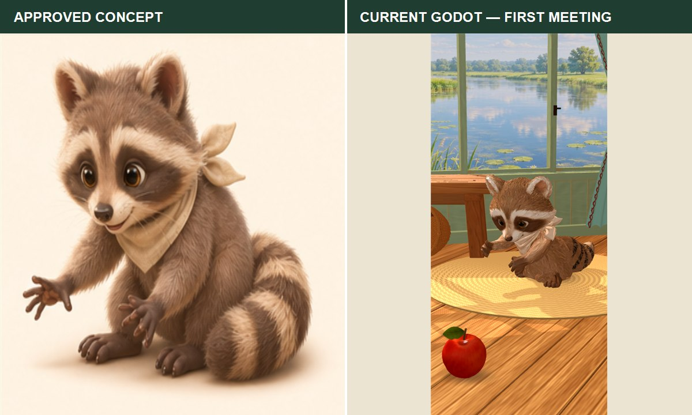

# Первая встреча: концепт и текущая игра

## Происхождение без подмены

- Слева: утверждённый образ Ричи из `AnimalPark_app/model-review/richi-v3/concept-vs-blender.png` (левая половина исходного comparison-файла).
- Справа: реальный QA-кадр текущей Godot-сцены до первого касания яблока — `.tmp/active-camera-audit/intro-after-390/before-touch.png`, размер экрана 390 × 844.
- При сборке изменены только кадрирование, масштаб и подписи; персонаж и сцена не ретушировались и не генерировались заново.

## Видимые отличия

- В концепте голова шире и круглее, морда короче, глаза крупнее и выразительнее; в игре голова уже, нос вытянут сильнее, маска вокруг глаз темнее и жёстче очерчена.
- Концепт выглядит мягче и пушистее: объём щёк, груди, лап и хвоста читается цельно. В игре мех более прядистый, корпус тоньше, кисти и пальцы выглядят длиннее и острее.
- Концепт показывает естественный широкий жест обеих лап. В игре одна лапа вытянута к яблоку, но поза ниже и компактнее, поэтому приглашение к взаимодействию менее эмоционально.
- Концепт нейтральный и студийный; текущая игра уже передаёт утверждённую сцену «Домик у тропы»: коврик, отдельное яблоко, тёплое дерево и вид на озеро.
- Платок сохранён, но в игре он светлее, объёмнее и сильнее закрывает шею.
