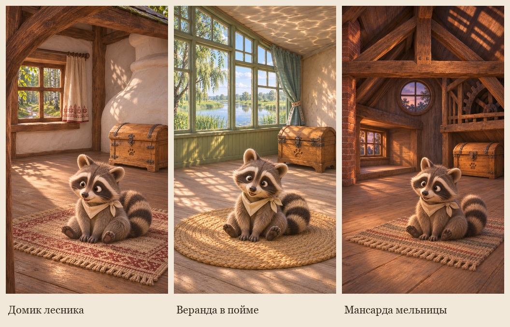

# Три варианта «Домика у тропы»

Это варианты художественного направления для обсуждения. В каждом кадре у малыша есть сундук с играми и место, куда после первой покупки встанет лежанка. Вид за окном, силуэт крыши и отражённый свет делают дом узнаваемым уже при первом запуске.

| Вариант | Что отличает комнату | Что перенести в Godot | Что проверить на телефоне |
| --- | --- | --- | --- |
| [Домик лесника](forester.webp) | Глубокий оконный откос, берёзовая тропа, светлая глиняная печь и тень ветвей. Коврик связывает комнату с первой встречей. | Сохранить исходные окно, лён, сундук и пол. Добавить один объём печи и ближнюю потолочную балку. Тень ветвей запечь в световую карту или использовать одну маску. | Лицо отделяется от дерева, сундук читается сбоку от хвоста, купленная лежанка помещается у окна. Самый короткий путь от существующей сцены. |
| [Веранда в пойме](river.webp) | Широкий горизонт, ивы за мятными рамами, речные блики на тёплой побелке. | Сделать одну секцию остекления и повторить вдоль стены. Реку и дальние деревья объединить в фон. Блики ограничить участком потолка. | За стеклом есть глубина. Блики и ветви не забирают внимание при жестах по Ричи. Средний объём новых моделей. |
| [Мансарда мельницы](mill.webp) | Треугольные стропила, круглое окно и частично видимое колесо. Ниша слева естественно подсказывает место будущей лежанки. | Потребуются стропильная ферма, фронтонное окно, колесо за ограждением и вечернее освещение. | Маска, глаза и хвост остаются различимыми в тёмном помещении. Это самый затратный вариант, подходит и для позднего улучшения дома. |

Три концепта созданы ImageGen по исходному изображению малыша у яблока. Общее задание для генерации — портрет 9:16, льняной платок и узнаваемая маска, сидящий енот занимает около трети высоты, сундук сбоку, свободное место под лежанку, спокойный передний план, без экранных надписей. Первая вариация строится вокруг побелки и утреннего берёзового света, вторая вокруг застеклённой веранды над рекой, третья вокруг конструкции вечерней мельницы. Для согласования точного вида доступны полноразмерные кадры по ссылкам в таблице.

## Что взяли из игрового референса

На опубликованных кадрах оригинальной My Talking Tom кухня и гостиная имеют разные постановки камеры. В кухне персонаж сидит за едой, на переднем плане находятся угощения. В гостиной хорошо видны тело и реакция на прикосновение. Внизу в обеих комнатах остаётся одна последовательность значков потребностей. В материалах автора также описаны выключение света перед сном и отдельные действия ухода. [Кадры и описание Outfit7](https://mytalkingtom.com/gameplay)

Для Ричи действует уточнение заказчика. Одно нажатие сразу меняет комнату, позу питомца и доступное действие. Вход в комнату сам по себе не пополняет шкалу. В кухне игрок подаёт яблоко к освобождённым лапам, в умывальной выбирает уже стоящую купель. Плавность оценивается по хвату и опоре внутри действия. Для навигации проверяется первый кадр после нажатия и быстрый возврат. Существующие игровые текстуры и материалы относятся к прототипу. Новое оформление дома выбирается отдельно.
