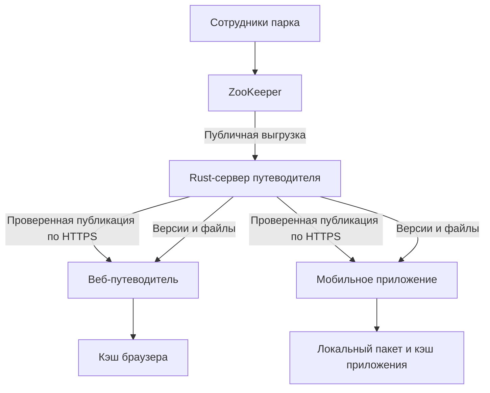

# Парк животных 3.0

Техническое описание путеводителя и план подключения к серверу. Состояние проверено 27 ноября 2026 года на ветке `3.0` и тестовой сборке Android r9. Задачи посетителя описаны в [PRODUCT.md](../../PRODUCT.md).

## Назначение и архитектура

Путеводитель помогает подготовить визит и ориентироваться в двух зонах парка. В него входят карта, каталог животных, поиск мест, кормления, аудиогид, информация о визите, расписание автобуса и автомобильный маршрут между гостевыми парковками. Карта строит пеший путь по гостевым дорожкам от GPS или выбранной точки. Для поездки в другую зону она сначала ведёт к разрешённому выходу, затем показывает варианты пересадки и сохраняет пункт назначения.

Целевая схема для веб-версии и мобильных приложений выглядит так.

| Часть | Ответственность |
| --- | --- |
| ZooKeeper | Сотрудники меняют описания, расположение животных, данные карты и кормления. Публичная выгрузка содержит поля для посетителей. Ветеринарные записи и диагнозы остаются в рабочей системе. |
| Rust-сервер | Axum и Tokio обслуживают веб-путеводитель и API. Сервер читает выгрузку с ключом только на чтение, проверяет схему и публикует согласованный снимок. Ключ и адрес выгрузки настраиваются на сервере. |
| Веб и APK | Посетительские экраны реализованы в `public/demo` на HTML, CSS и JavaScript. В APK они запускаются внутри Android WebView через Capacitor. MapLibre отображает объёмную карту, Leaflet обеспечивает плоский режим. |
| Данные и расчёты в клиенте | `guide-data.js` отвечает за публикацию и кэш, `map-data.js` за загрузку и проверку данных карты. `map-guest-geometry.js` вычисляет путь и расстояние, `feeding-model.js` рассчитывает календарь и ближайшие события. `park-map.js` управляет экраном и активным маршрутом. |
| Офлайн | Локальная геометрия и GPS позволяют рассчитывать путь на устройстве. Веб-версия сохраняет страницы, данные и аудио через Service Worker и Cache Storage. Android r9 содержит карту, расписание, каталог и семь аудиозаписей. |

## Что работает сейчас

### Источник данных

- Локальный Rust-сервер на порту `8170` работает в режиме `park-files`. Это подтверждено ответом `200` от `/api/health`. API отдаёт версии каталога, кормлений, привязки карты, границ и дорожек.
- Подключение к публичной выгрузке ZooKeeper реализовано на стороне Rust. После настройки сервер опрашивает источник примерно раз в минуту, фильтрует поля и сохраняет последнюю принятую публикацию при ошибке. Пока она хранится в памяти процесса. После перезапуска сервер в режиме ZooKeeper должен заново получить выгрузку. [Настройка и контракт](../../docs/guide-data-source.md) · [Код публикации](../../server/src/publication.rs#L148)
- Публикация объединяет каталог, места, привязку плана, границы, дорожки и кормления. Версия доступна через `/api/v1/guide`, снимок — через `/demo/guide-publication.json`. API поддерживает `ETag` и `304` для проверки версии. [Rust API](../../server/src/main.rs#L183)
- Веб-клиент проверяет снимок при открытии страницы, при возврате в приложение, восстановлении связи и примерно раз в минуту в режиме публикации, пока страница видима. Карта, каталог и кормления получают обновление по событию. Карта открывает сохранённую публикацию или ранее подтверждённый локальный источник и проверяет обновления в фоне. При первом открытии без сохранённых данных и известного источника запрос к публикации может ждать до 3,5 секунды. [Загрузка снимка](../../public/demo/guide-data.js)
- В Android r9 адрес снимка строится относительно страницы, которая открыта на `https://localhost` внутри APK. Сборка работает с вложенным пакетом, включая первый запуск без связи. Для обновлений установленного приложения требуется настроить адрес публичного Rust API.

### Тихая подкачка

Веб-версия запускает очередь аудио после загрузки экрана и при возвращении связи. Файлы скачиваются по одному. Сначала идут записи по заданному порядку для выбранной зоны, с ориентиром на близость к её входу. Сохранённые файлы пропускаются. При обрыве сети текущий запрос отменяется. Для очередной попытки используется пауза в 20 секунд, на одну запись отводится до 12 секунд. Слабая связь определяется по доступному сетевому признаку `2g` или тайм-ауту скачивания. [Очередь и состояния](../../public/demo/guide-offline.js#L63) · [Порядок аудио](../../public/demo/audio-stops.js)

| Ситуация | Поведение |
| --- | --- |
| Сохранение в процессе | Небольшой индикатор «Сохраняем путеводитель…». Посетитель может пользоваться экраном. |
| Слабая связь | «Слабая связь.» Скачивание откладывается, ранее сохранённые записи доступны. |
| Связь пропала | «Нет интернета. Доступны сохранённые данные». Карта и расчёт маршрута используют локальные ресурсы. |
| Открыли запись, которой ещё нет в кэше | В веб-версии при потере связи плеер показывает «Подключитесь к интернету». Записи, уже вложенные в APK, доступны сразу. |

Последовательность загрузки и запуск плеера независимы. Посетитель включает рассказ сам. GPS используется для навигации по запросу посетителя.

### Где проходят границы текущей версии

- Тихое обновление рассчитано на открытое приложение. Загрузка после полного закрытия процесса потребует отдельных системных задач для Android и iOS, если такой сценарий понадобится.
- APK и веб-комплект включают начальные записи, подложку карты и метаданные аудиогида. Остановки, парковки, геометрия проезда и расписание автобуса находятся в `park-transfer.js`. Для отдельных обновлений транспорта и аудио эти данные потребуется добавить в публичную публикацию или в отдельный версионируемый ресурс.
- Для тестового APK r9 в `dist` отдельно упаковали `public/demo` и добавили переход с корневой страницы на путеводитель. Затем запустили `cap sync android` и `:app:assembleDebug`. Штатный Vite build использует корневую React-точку входа. Подготовка тестового пакета пока выполняется локально вне репозитория.
- Текущий профиль рассчитан на гостя. Личный кабинет, история покупок и программа лояльности потребуют отдельного серверного контура с авторизацией, правилами начисления и кассовой интеграцией.

## Что нужно для работы с сервером парка

1. **Развернуть Rust-сервер по публичному HTTPS-адресу.** На сервере указать адрес публичной выгрузки ZooKeeper и выдать отдельный ключ на её чтение. Проверить `/api/health` и публикацию через тестовый домен. Сохранять последнюю принятую версию на диске, чтобы старт Rust переживал временную недоступность ZooKeeper.
2. **Подключить Android и iOS к этому API.** Задать адрес публичного Rust API в конфигурации сборки. Использовать один загрузчик публикаций и разные адреса для браузера и WebView. Настроить доступ с требуемых origin. При запуске сразу показывать локальный пакет или последний корректный снимок, а проверку версии выполнять в фоне во время работы приложения.
3. **Обновлять данные одной согласованной версией.** Прочитать версию, загрузить и проверить новый снимок, сохранить его целиком и только после этого оповестить экраны. При ошибке оставить предыдущую версию. Текущую навигацию сохранять при правке описаний и расписаний. При закрытии используемой дорожки или переносе цели пересчитать маршрут по новой схеме. Сейчас обновление снимка завершает маршрут даже при изменении описания. [Обновление карты](../../public/demo/park-map.js#L1271)
4. **Обновлять медиа независимо от APK.** Публиковать версионируемый каталог MP3 и изображений с размером и контрольной суммой. Загружать недостающие файлы после основных данных, начиная с ближайших к входу в выбранной зоне. Сохранять предыдущую рабочую запись до завершения загрузки новой.
5. **Подключить сайт парка.** Добавить входы в тот же аудиогид и карту на официальном сайте. Использовать постоянные публичные идентификаторы животных и мест, чтобы QR-ссылки продолжали открывать нужную карточку после обновлений.

## Проверка перед пилотом

| Сценарий | Критерий |
| --- | --- |
| Правка животноводом | Изменённые описание, точка вольера и кормление появляются на открытых экранах после обновления публикации. |
| Потеря связи | Установленный клиент открывает карту, находит вольер и строит путь по локальным дорожкам. Сохранённый рассказ проигрывается. После возврата сети очередь продолжает скачивание. |
| Обновление во время прогулки | Правка описания сохраняет маршрут. Закрытие дорожки вызывает пересчёт. Перезапуск Rust сохраняет доступ к последнему валидному снимку. |
| Безопасность и совместимость | Клиенты запрашивают только публичный Rust API. Ключ ZooKeeper и внутренние медицинские поля отсутствуют в публичном ответе и пакете. На Android и iPhone проверены разрешение на точную геолокацию, GPS на территории, системные отступы и работа без связи. |

Проверены локальные данные, контракт через имитацию выгрузки ZooKeeper, открытие карты при задержке ответа и обновление экрана без перезагрузки. Для r9 проверены подпись APK, запуск и офлайн-сценарии из содержимого APK в браузере с имитацией GPS. Более ранняя сборка r7 проверялась в BlueStacks. Пилот с рабочей выгрузкой и физическими телефонами — следующий этап. [Тест публикации](../../scripts/check-guide-publication.cjs) · [Тест подкачки](../../scripts/check-guide-downloads.cjs) · [Тест маршрутов](../../scripts/check-guest-navigation.cjs)
